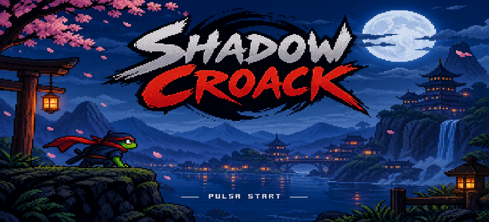
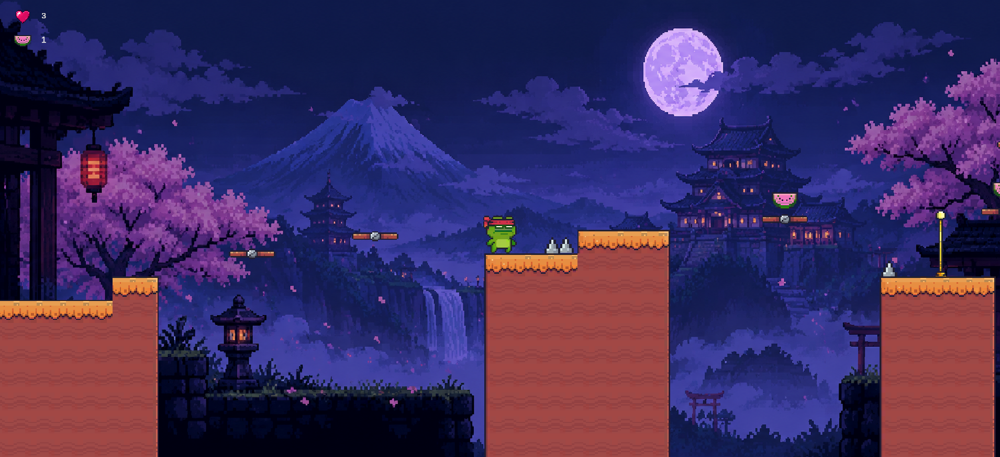
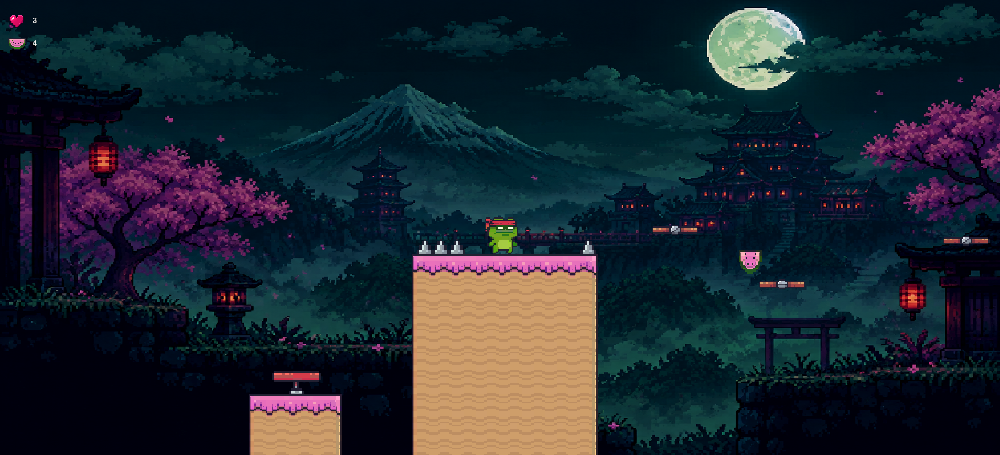
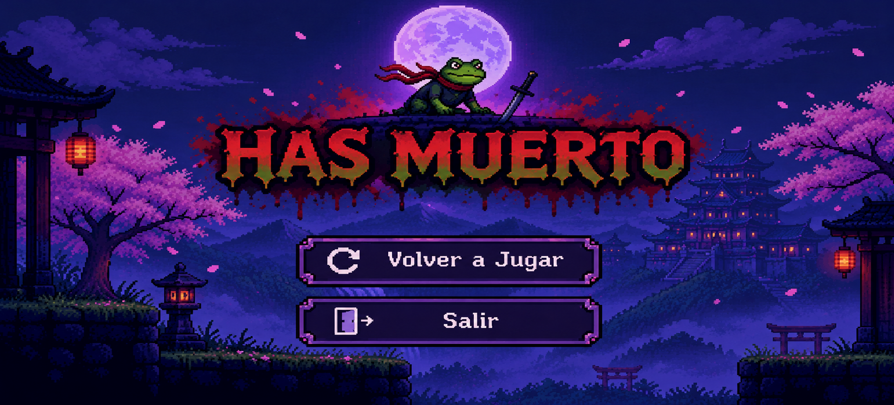
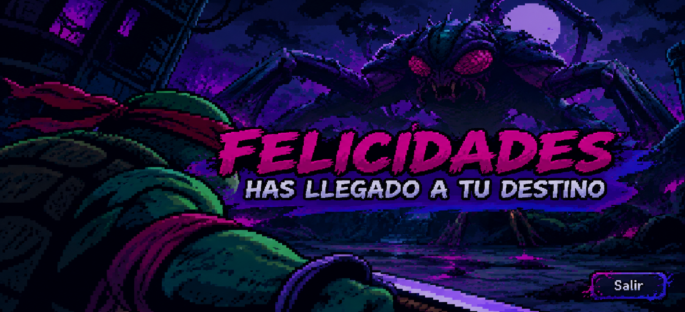

# Shadow Croack

**Autor:** Iago Fernández Gómez

## Descripción del juego

Shadow Croack es un videojuego de plataformas en 2D desarrollado en Unity y programado en C#. El protagonista es una rana ninja que debe recorrer diferentes escenarios, superar obstáculos y evitar peligros para conseguir completar todos los niveles.

El objetivo principal es avanzar por los escenarios hasta alcanzar el final de cada nivel, intentando evitar las trampas y aprovechando las habilidades del personaje para superar las distintas plataformas.

## Mecánicas de juego

El juego cuenta con diferentes mecánicas que permiten al jugador interactuar con el entorno:

- **Movimiento:** desplazamiento horizontal del personaje para recorrer los escenarios.
- **Salto y doble salto:** permite alcanzar plataformas más elevadas y superar obstáculos que no serían accesibles con un único salto.
- **Sistema de vidas:** el personaje dispone de tres vidas. Al entrar en contacto con pinchos u otros peligros, pierde una vida.
- **Checkpoints:** permiten guardar una posición de referencia para que el personaje pueda regresar a ella después de recibir daño.
- **Coleccionables:** durante los niveles se pueden recoger melones, que se contabilizan en la interfaz del juego.
- **Animaciones:** el personaje dispone de diferentes animaciones para representar sus acciones, como permanecer quieto, correr, saltar, caer, recibir daño y morir.
- **Efectos de sonido:** se incluyen sonidos para determinadas acciones del personaje y eventos del juego.

## Pantallas del juego

El juego dispone de diferentes pantallas que permiten gestionar el inicio, el desarrollo y la finalización de las partidas:

- **Menú principal:** pantalla inicial desde la que se puede comenzar a jugar.
- **Niveles:** escenarios en los que el jugador debe avanzar, recoger melones y superar los diferentes obstáculos.
- **Pantalla de muerte:** aparece cuando el personaje pierde todas sus vidas y permite volver a intentarlo o salir del juego.
- **Pantalla de victoria:** muestra la finalización satisfactoria de la partida.

## Capturas del juego

### Pantalla de inicio

### Nivel 1

### Nivel 2

### Pantalla de muerte

### Pantalla de victoria

## Tecnologías utilizadas

- Unity 6
- C#
- Visual Studio